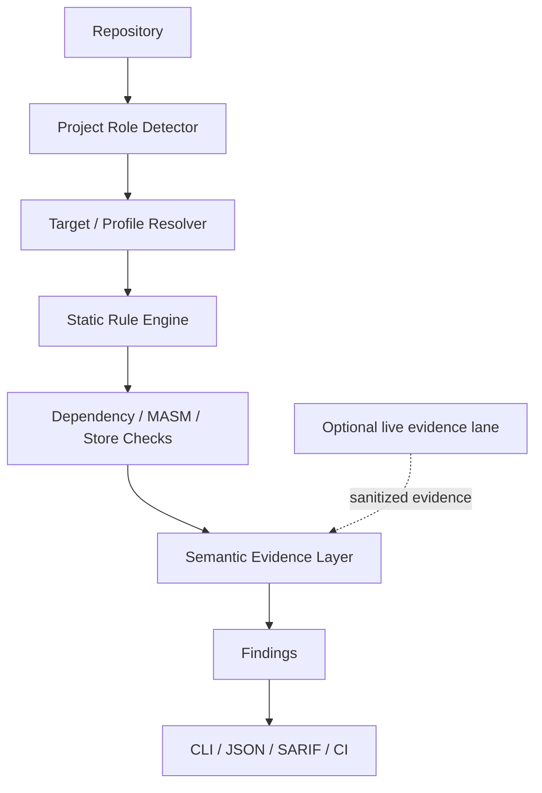

# Miden Preflight

**Compatibility and migration preflight for Miden builders.**

Live demo: https://chapaevv123.github.io/miden-preflight/

Miden changes quickly across testnet and devnet releases, SDK families, toolchains, MASM package structure, client stores, fee semantics, and private-note workflows. A project can look correct in source while resolving an incompatible dependency family or carrying a stale state assumption.

Miden Preflight is a local-first scanner that detects those risks before they become testnet debugging sessions. It classifies the repository, resolves the intended target profile, runs evidence-aware checks, and emits human-readable, JSON, or SARIF findings.

> Independent developer tool. Not affiliated with or endorsed by Miden.

## Quick start

Requires Python 3.11 or newer.

```console
python -m pip install -e .
miden-preflight scan .
miden-preflight scan . --target miden-0.16
miden-preflight explain MIDEN016-MASM-001
miden-preflight scan . --json
miden-preflight scan . --sarif
```

These commands are implemented and covered locally. The `miden-testnet-0.17.1` artifact is a bounded live-evidence profile, not a complete 0.17.1 static ruleset.

## What it checks

- Conservative project-role inference: `sdk-consumer`, `contract`, `wallet`, `node`, `tooling`, `hybrid`, or `unknown`.
- Declared versus lockfile-resolved SDK versions and cross-family drift.
- Target-aware toolchain pins and CLI ownership.
- Explicit and transitive MASM module reachability.
- Removed or migrated API signatures.
- Store migration safety without deleting or resetting state.
- Fee, ChainAnchor, and private-note readiness with unsupported semantics labeled `REVIEW_REQUIRED`.
- Machine-readable JSON and SARIF suitable for CI.

Role awareness matters: an SDK-only web application is not warned merely because it does not own a Miden toolchain. A hybrid frontend and contract repository still receives the toolchain check. Calibration reduced five contextual `MIDEN016-TOOL-001` false positives to zero while retaining the high-severity mutation suite.

## Version profiles

| Profile | Level | Meaning |
|---|---|---|
| `miden-0.16` | Full rule support | Implemented static compatibility, migration, MASM, store, and readiness rules. |
| `miden-testnet-0.17.1` | Bounded live profile | Sanitized network, fee, transaction, and private-note lifecycle evidence. It does not imply complete 0.17.1 rule coverage. |
| Unsupported semantics | `REVIEW_REQUIRED` | No failure is manufactured when first-party executable proof is unavailable. |

## Proven on official Miden sources

These findings were reproduced against first-party source snapshots. The fixes are local; none has been submitted or accepted upstream.

| Source | Problem | How Preflight found it | Local remediation | Status |
|---|---|---|---|---|
| `0xMiden/web-sdk` wallet example (`029aba8`) | Manifest declared the 0.17.3 SDK family while its colocated pnpm importer resolved 0.14.5. | `MIDEN016-SDK-002` compared declared and resolved direct dependencies. | Regenerated an isolated lockfile with the repository's pinned pnpm; rescan removed the drift finding. | Local fix validated; not submitted. |
| `0xMiden/midenup` (`734b14a`) | PATH prefixes were joined with `:`, breaking Windows PATH semantics and losing `OsString` safety. | Platform reproduction plus Preflight portability investigation. | Prepared `split_paths`/`join_paths` patch and focused tests. Windows GNU check passed; MSVC remains unverified. | Local patch ready; not submitted. |
| Rust SDK `v0.16.0` docs (`4e8407b`) | Stable library documentation pinned `0.16.0-alpha.1` and showed stale authentication construction. | Version-aware docs scan plus tagged-source comparison. | Corrected the stable pin and examples locally. | Local fix validated; not submitted. |

In the Step 4 audit, Preflight discovered two of three confirmed defect groups: **66.7%**, with confirmed defect groups as the denominator.

## Live Miden Testnet validation

Sanitized evidence from Miden Testnet 0.17.1:

- Transaction: `0x06d17ae905aba06fd56c09746e25024679ed6b81afdec849167c54d166a39d9c`
- Block: `167209`
- Transfer: `0.000001 USDCX`
- Actual fee: `0.000133 USDCX`
- Private-note lifecycle proven: `CREATED`, `COMMITTED`, `DELIVERED`, `DISCOVERED`, `CONSUMABLE`.

Not proven: note consumption, live ChainAnchor semantics, retry/duplicate handling, Guardian/multisig, and full store semantics. Consumption was intentionally not performed: Bread Wallet 1.17.1 did not expose a safe unsigned claim-fee preview, while its conservative claim reserve could be materially larger than the one-unit note. That boundary is recorded rather than promoted into a false claim.

## Architecture



The semantic layer labels its proof type. A local model is never presented as official MockClient execution, and unavailable semantics remain review items.

## CI and SARIF

```yaml
- name: Miden Preflight
  run: miden-preflight scan . --target miden-0.16 --sarif > miden-preflight.sarif
- uses: github/codeql-action/upload-sarif@v3
  with:
    sarif_file: miden-preflight.sarif
```

The intended workflow is: repository → role detection → target resolution → compatibility scan → migration findings → CLI/JSON/SARIF. GitHub OAuth or a GitHub App is not required.

## Demos

- `demo/official-wallet-lock/run_demo.ps1`: a deterministic 30–45 second official-source reproduction. It scans the mismatched manifest/lockfile pair, shows the exact finding, then scans the isolated corrected pair.
- `demo/live_evidence.ps1`: prints sanitized Testnet 0.17.1 transaction, fee, and private-note lifecycle evidence. It requires no wallet or secrets and performs no network writes.

## Security and privacy

- Static/read-only scanning is the default.
- Scans run locally and require no external service.
- No private key, seed phrase, wallet password, or wallet storage is required.
- The scanner never deletes or resets a store.
- Live write validation is optional, separately owner-gated, and outside normal scanning.
- Public evidence contains public identifiers only; it does not contain signing material.

## Limitations

- Native 0.17.1 rule coverage is incomplete; the included profile is bounded live evidence.
- Official v0.16 MockClient execution is partially blocked in the current Windows GNU environment by pinned `miden-core-lib 0.29.4` MASM resolution.
- The midenup patch has a Windows GNU build/check pass, but its focused GNU tests are blocked by pre-existing Unix-only test modules and MSVC remains unverified locally.
- ChainAnchor is not live-proven.
- Private-note consumption was intentionally not executed.
- Guardian/multisig remains `REVIEW_REQUIRED`.
- Remaining contextual account-delta matches require further noise calibration.

## License and attribution

Miden Preflight is prepared for release under the MIT License. Minimal demo fixtures reproduce dependency metadata facts; no substantial upstream implementation is vendored. Miden project names and repository references identify compatibility targets and do not imply affiliation.

Built by Pulse.
