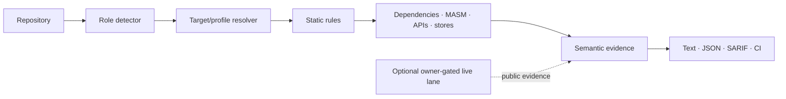

# Architecture and evidence boundaries

Every rule carries role applicability metadata. Semantic assertions carry a proof type, and unsupported behavior remains `REVIEW_REQUIRED`. The default path is local, static, and read-only.
